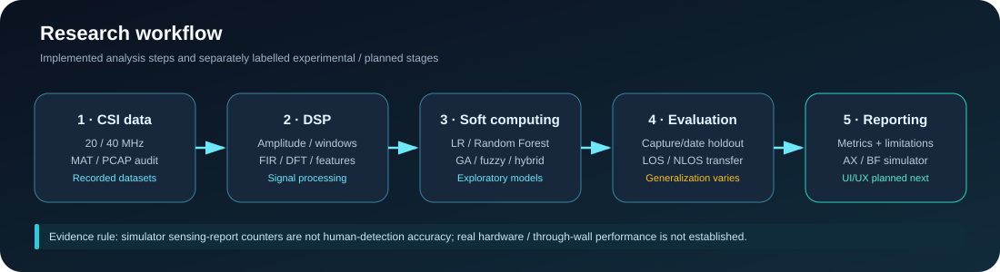
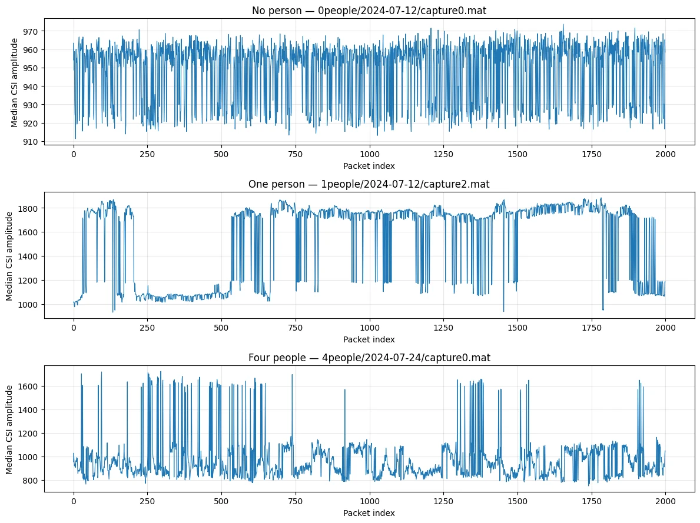
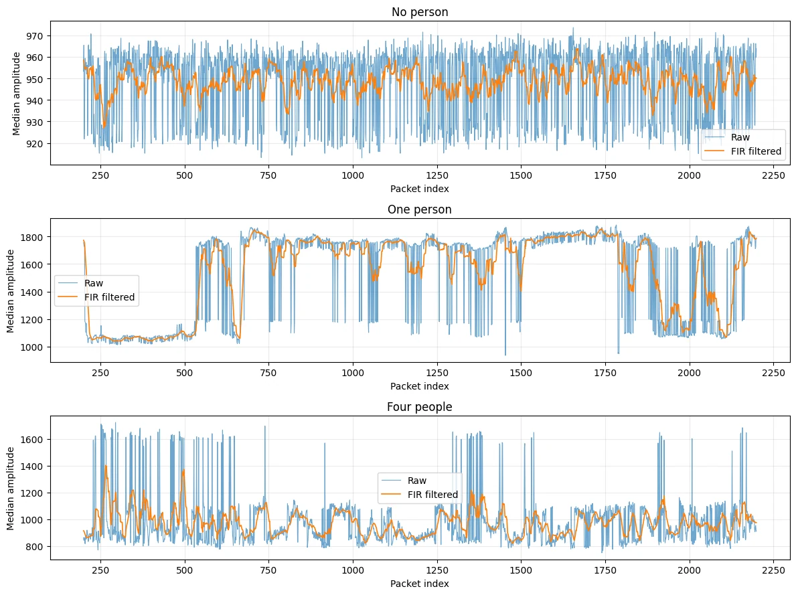
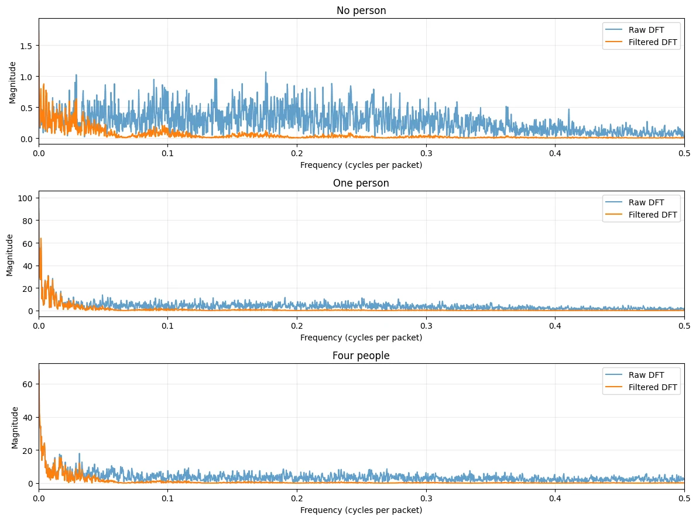
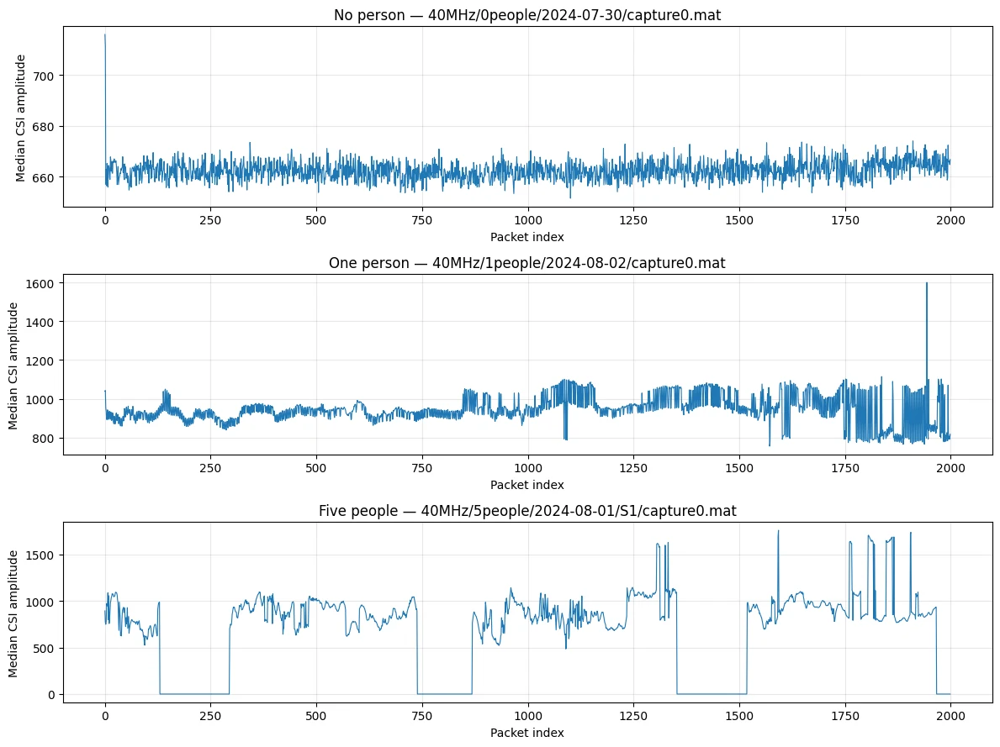
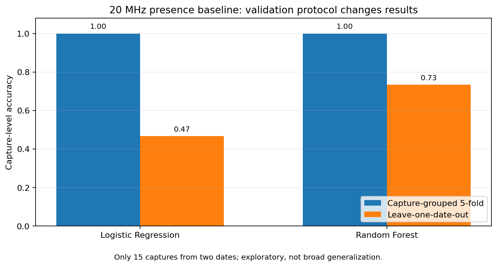
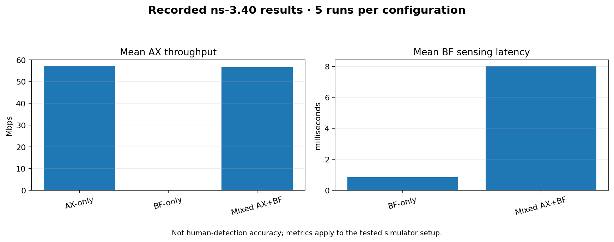
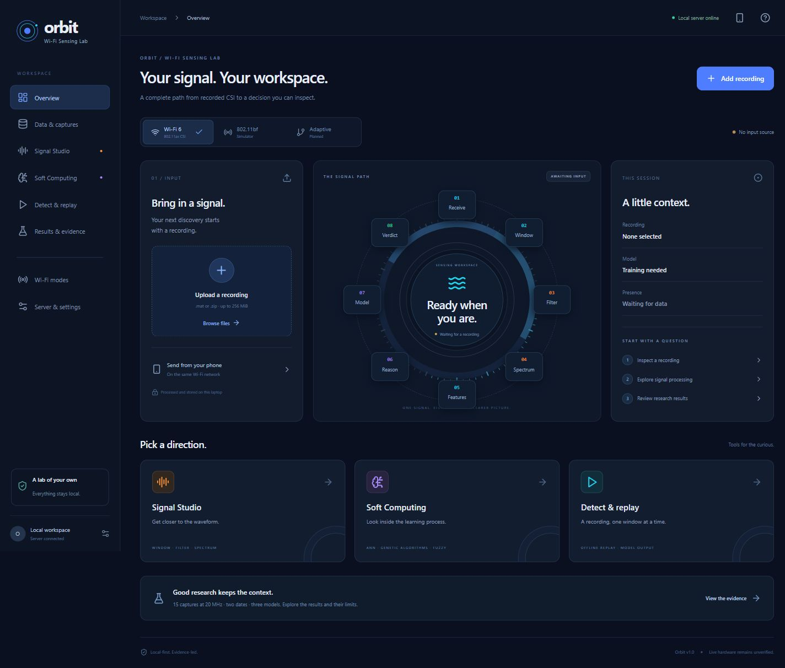

# Wi-Fi CSI Human Presence & Activity Sensing

**Combining Wi-Fi 6 Channel State Information (CSI), Digital Signal Processing, Machine Learning, and Soft Computing**

<p>
  <a href="https://colab.research.google.com/drive/1iFoaTazemwuRKRnVC7APWzceNzxh0OiK?usp=sharing">
    
  </a>
  
  
  
  
</p>

**Recorded CSI Experiments · DSP · AI/ML · Genetic Algorithms · Fuzzy Logic · AX/BF Simulation**

</div>

---

## Project Overview

This project explores the use of Wi-Fi Channel State Information (CSI) for human-presence and activity sensing. Instead of relying only on cameras or wearable sensors, it studies changes in wireless channel measurements and processes them using signal processing and machine-learning techniques.

The work combines:

- **Digital Signal Processing:** CSI amplitude processing, windowing, FIR filtering and DFT analysis.
- **Machine Learning:** Logistic Regression and Random Forest classifiers.
- **Soft Computing:** Genetic Algorithm (GA) feature selection and fuzzy-rule experiments.
- **Cross-domain evaluation:** Testing models across LOS/NLOS environments and antenna configurations.
- **Wi-Fi AX/BF simulation:** Comparing selected Wi-Fi 6 and Wi-Fi sensing simulator configurations.
- **Future application:** Planning a laptop-hosted interface accessible from a phone on the same local network.

> **Research status:** These are exploratory software and simulation experiments. Real-hardware through-wall detection, live CSI capture on the intended device, and native IEEE 802.11bf operation on consumer hardware have not been verified.

## Research Notebook

The main notebook contains the experiments, saved outputs, tables and graphs.

**[Open the Wi-Fi 6 CSI Research Notebook in Google Colab](https://colab.research.google.com/drive/1iFoaTazemwuRKRnVC7APWzceNzxh0OiK?usp=sharing)**

Access depends on the notebook's sharing permissions.

## Project Pipeline

<p align="center">
  
</p>

1. **Dataset inspection:** Examine CSI arrays, configuration files, labels and available packet-capture data.
2. **Signal processing:** Convert complex CSI to amplitude-derived features, create windows and compare FIR filtering and DFT summaries.
3. **Model development:** Evaluate Logistic Regression, Random Forest, GA-based feature selection and fuzzy rules.
4. **Generalization testing:** Investigate performance across recording dates, LOS/NLOS settings and antenna configurations.
5. **Simulator comparison:** Compare selected AX-only, BF-only and mixed AX+BF simulator measurements.
6. **Application planning:** Define the interface, data flow and future integration requirements.

## 1. CSI Dataset and Processing

The project uses the public [20 MHz CSI dataset on Zenodo](https://zenodo.org/records/17225694). The recorded workflow inspected 15 MATLAB captures across two recording dates.

The inspected 20 MHz captures use 256 subcarriers. The baseline feature pipeline uses 256-packet windows with a 128-packet hop and four statistics per subcarrier, producing 1,024 features per window.

The recorded dataset contained:

- 8 captures labelled no person present.
- 7 captures labelled person present.
- MATLAB v7.3 data inspected using `h5py`.
- CSI amplitude-derived features used for baseline modelling.

Raw datasets and large PCAP archives are not included in this repository.

## 2. CSI Signal Visualizations

### 20 MHz CSI Examples

The following saved plots show CSI amplitude traces from recorded captures. Signal differences are useful for exploration, but the plots alone do not prove reliable human detection.

<p align="center">
  
</p>

### FIR Filtering

A 15-tap moving-average FIR filter was evaluated on CSI amplitude traces. The results were compared against raw features to check whether filtering helped the classifiers.

<p align="center">
  
</p>

### DFT Analysis

DFT magnitude was used to inspect frequency-domain characteristics of raw and filtered traces.

<p align="center">
  
</p>

### 40 MHz CSI Examples

The 40 MHz dataset workflow inspected 11 MATLAB captures with 512 subcarriers and included PCAP/CSI reconciliation.

<p align="center">
  
</p>

## 3. Presence Detection: Validation Matters

The measured scores vary substantially depending on the validation protocol. This is important because windows from the same recording or recording conditions can be more similar than data collected on a different day.

<p align="center">
  
</p>

### Baseline Results on 20 MHz CSI

| Evaluation protocol | Model | Window accuracy | Capture accuracy | Capture F1 |
|---|---|---:|---:|---:|
| Capture-grouped 5-fold | Logistic Regression | 0.9802 | 1.0000 | 1.0000 |
| Capture-grouped 5-fold | Random Forest | 0.9771 | 1.0000 | 1.0000 |
| Leave-one-date-out, 2 dates | Logistic Regression | — | 0.4667 | 0.6000 |
| Leave-one-date-out, 2 dates | Random Forest | — | 0.7333 | 0.7778 |

**Interpretation:** The capture-grouped evaluation reported 100% capture scores, but it did not hold out an entire recording date. When one date was held out for testing, the scores were lower.

Only two dates and 15 captures were available. These results are exploratory and do not establish generalization to new rooms, people, devices or recording conditions.

### Raw Features vs FIR-Filtered Features

| Features | Model | Capture accuracy | Precision | Recall | F1 |
|---|---|---:|---:|---:|---:|
| Raw | Logistic Regression | 0.6667 | 0.6000 | 0.8571 | 0.7059 |
| Raw | Random Forest | 0.7333 | 0.6364 | 1.0000 | 0.7778 |
| FIR filtered | Logistic Regression | 0.6000 | 0.5556 | 0.7143 | 0.6250 |
| FIR filtered | Random Forest | 0.7333 | 0.6364 | 1.0000 | 0.7778 |

In this evaluation, FIR filtering did not improve the Random Forest metrics and reduced the Logistic Regression metrics. Filtering is therefore treated as an experiment rather than an automatic improvement.

## 4. Soft Computing: GA and Fuzzy Logic

### Genetic Algorithm Feature Selection

The GA experiment selected 8 features in one outer fold and 12 features in the other.

| Method | Capture accuracy | Macro-F1 | Presence F1 | Balanced accuracy |
|---|---:|---:|---:|---:|
| Raw Random Forest | 0.7333 | 0.7222 | 0.7778 | 0.7500 |
| GA + Random Forest | 0.8000 | 0.7964 | 0.8235 | 0.8125 |

The recorded result suggests that feature selection helped in this specific small-data evaluation. More recordings and stricter external validation are required before drawing a general conclusion.

### Fuzzy-Rule Experiment

| Metric | Recorded value |
|---|---:|
| Capture accuracy | 0.8000 |
| Precision | 1.0000 |
| Recall | 0.5714 |
| Presence F1 | 0.7273 |
| Macro-F1 | 0.7847 |
| Balanced accuracy | 0.7857 |

These are preliminary results from a small dataset. The fuzzy-rule method did not show that it was universally better than Random Forest.

## 5. 40 MHz CSI: Generalization Caveat

The notebook's 40 MHz workflow inspected 11 MATLAB captures and included a PCAP/CSI reconciliation process.

Some recorded evaluations reported 100% scores across threshold variants. However, the experiment was small, and the recorded analysis warned that recording date and class distribution may confound the results.

A separate always-predict-presence reference on a 33-capture table gave 72.73% accuracy and 0.50 balanced accuracy, with 9 false alarms.

For this reason, the 100% 40 MHz result is treated as exploratory and potentially confounded, not as proof of generalization.

## 6. LOS/NLOS Cross-Domain Evaluation

Four feature domains were examined:

| Domain | Feature matrix shape |
|---|---:|
| NLOS / BQ | 452 × 208 |
| NLOS / PIFA | 440 × 208 |
| LOS / BQ | 460 × 208 |
| LOS / PIFA | 465 × 208 |

Twelve directional transfers were evaluated for presence detection and three-class activity recognition.

The scale-invariant hybrid v1 beat both comparison baselines in only **1 of 12 presence-transfer directions** and **4 of 12 activity-transfer directions**.

### Selected Presence-Transfer Results

| Transfer | Method | Accuracy | Balanced accuracy | Macro-F1 |
|---|---|---:|---:|---:|
| NLOS/BQ → LOS/BQ | Raw Logistic Regression | 0.9935 | 0.9952 | 0.9926 |
| NLOS/BQ → LOS/BQ | Hybrid v1 | 0.9109 | 0.9323 | 0.9040 |
| NLOS/PIFA → NLOS/BQ | Raw Random Forest | 0.8628 | 0.7923 | 0.8222 |
| NLOS/PIFA → NLOS/BQ | Hybrid v1 | 0.6726 | 0.5000 | 0.4021 |

**Takeaway:** Model performance depends on the environment and antenna configuration. The hybrid approach was not a universal improvement, and a high score in one domain should not be assumed to transfer to another.

## 7. Wi-Fi AX/BF Simulator Study

A separate experiment compared three configurations using a partial ns-3.40 research implementation, with five valid runs per configuration.

<p align="center">
  
</p>

### Mean Results Across Five Runs

| Configuration | Valid runs | Mean BF sensing latency | Mean AX throughput |
|---|---:|---:|---:|
| AX-only | 5/5 | Not applicable; BF disabled | 57.1744 Mbps |
| BF-only | 5/5 | 0.8540 ms | Not applicable |
| Mixed AX+BF | 5/5 | 8.0313 ms | 56.5456 Mbps |

For this tested setup:

- Mixed AX+BF throughput was approximately 1.10% lower than AX-only throughput.
- Mixed AX+BF reported BF sensing latency was approximately 9.4 times the BF-only value.
- Throughput and sensing latency are separate measurements and should not be treated as one combined score.

### Simulation Limitations

- Successful MAC sensing reports are **not** human-presence classification accuracy.
- BF sensing latency is **not** machine-learning inference time or end-to-end application latency.
- The AX-only and BF-only configurations did not use identical offered user-data loads.
- The simulator is a partial research implementation, not proof of standards conformance or physical 802.11bf operation.
- Five runs per configuration are exploratory; the random seed did not guarantee identical topology layouts.
- The simulation does not demonstrate through-wall sensing on real hardware.

## 8. Planned Application Modes

| Mode | Current evidence | Status |
|---|---|---|
| Wi-Fi 6 / 802.11ax CSI | Recorded datasets and offline model experiments | Offline analysis available; live capture unverified |
| 802.11bf sensing | Standards research and simulator comparison | Compatible physical hardware and firmware not verified |
| Proposed Adaptive Wi-Fi Sensing | Proposed architecture | Adapter integration and mode-selection logic not implemented or validated |

The proposed application would run on a laptop and be accessible from a phone on the same trusted local network.

**The application is not finished.** Requirements, navigation, UI/UX screens and the integration architecture need to be developed before implementation.

## 9. Current Limitations and Next Steps

The repository contains starter inspection and baseline scripts, while the larger research workflow still relies on notebook cells, datasets, intermediate artifacts and a separate ns-3 build.

Planned improvements:

- Refactor notebook experiments into documented, standalone scripts.
- Add reproducible split manifests and consolidated evaluation tables.
- Organize confusion matrices, plots and experiment metadata.
- Collect more recordings across dates, rooms, people and configurations.
- Audit the 40 MHz evaluation for recording and class confounding.
- Design the application requirements, navigation and responsive UI before coding.
- Integrate only tested data-processing, model and simulator functions.
- Test real hardware separately before making live-sensing or through-wall claims.

Raw CSI archives, large PCAP files, datasets and multi-gigabyte runtime backups should remain outside the repository.


## Research artifacts and model comparison

The curated experiment records, validation summaries, dataset audits, and supporting figures are available in the repository:

- [Research progress](docs/research_progress.md)
- [Experiment log and limitations](docs/experiment_log.md)
- [20 MHz / 40 MHz model comparison: Logistic Regression, Random Forest and ANN](docs/model_comparison_20mhz_40mhz.md)
- [AX/BF simulator evaluation](docs/ax_bf_simulator_evaluation.md)
- [Results data dictionary](docs/results_data_dictionary.md)
- [Model metrics](results/presence_model_comparison_by_bandwidth.csv)
- [Capture-level predictions](results/capture_level_model_predictions.csv)
- [Data-quality audits](results/csi_capture_quality_audit.csv) and [window audit](results/csi_window_quality_audit.csv)
- [Validation folds and fit warnings](results/model_validation_fold_details.csv)
- [AX/BF runs](results/ax_bf_simulation_runs.csv) and [summary](results/ax_bf_simulation_summary.csv)
- [Combined comparison notebook](notebooks/wifi_csi_bandwidth_model_comparison.ipynb)

**Model evaluation caveat:** the latest 20 MHz date-held-out comparison reports 0.4667 capture accuracy for Logistic Regression and 0.6667 for both Random Forest and ANN/MLP across only two dates. The latest 40 MHz capture-held-out comparison reports 1.0000 capture accuracy for all three models, but all no-person captures are dated 2024-07-30 and person-present captures are dated 2024-08-01/02. Treat the 40 MHz scores as exploratory and confounded, not as evidence of robust generalization. See the linked report for details. These offline results do not establish live or real-hardware through-wall sensing.

## 10. Data, Code and Research Sources

### Dataset

- [Zenodo CSI dataset — 20 MHz](https://zenodo.org/records/17225694)

### Research Paper

Meneghello, Chen, Cordeiro and Restuccia, “Toward Integrated Sensing and Communications in IEEE 802.11bf Wi-Fi Networks,” *IEEE Communications Magazine*, July 2023.

- [DOI: 10.1109/MCOM.001.2200806](https://doi.org/10.1109/MCOM.001.2200806)

### Reference Code

- [SHARPax — GitHub](https://github.com/francescamen/SHARPax)

This project uses a different dataset and adapts general CSI-processing concepts. It does not claim an exact reproduction of the SHARPax experiments.

### Standards and Simulator

- [IEEE 802.11ax — IEEE Standards Association](https://standards.ieee.org/ieee/802.11ax/7180/)
- [IEEE 802.11bf — IEEE Standards Association](https://standards.ieee.org/ieee/802.11bf/11574/)
- [IEEE 802.11bf ns-3 research implementation](https://github.com/idolumbantobing/IEEE_802.11bf)

---

<div align="center">

**Research-first project · Results reported with validation limitations · Real-hardware sensing remains unverified**

</div>


## Orbit v1.1: saved datasets, themes and Learning Lab

The app now includes saved-dataset selection, new-data drop/upload, a photo/video/audio library, four persistent themes, a quiet presentation view, single/all-classifier replay, and real phone-sharing controls. **Soft Computing** is now **Learning Lab**. Use `Start-Orbit-Server.cmd` to launch laptop + phone mode. See [the demo guide](docs/orbit_demo_guide.md).

Data and trained model artifacts are stored only in the local `orbit-data/` folder. They are not committed to GitHub.

## Run the Orbit application

The local **Orbit — Wi-Fi Sensing Lab** application is now included: circular workspace, local MAT/ZIP uploads, real DSP experiments, leakage-safe model training, GA/fuzzy labs, offline replay and the recorded research evidence.

```powershell
python launch_orbit.py
```

Windows: double-click `Start-Orbit.cmd`. Phone access: `python launch_orbit.py --lan`. Open **http://127.0.0.1:8765** and enter the access code printed in the terminal. Python 3.10+ is required; the first launch installs dependencies into a private environment. The frontend is prebuilt.



---

<div align="center">


## Step 1 audit update

See docs/step1_audit.md for GA experiment differences, held-out replay provenance and the validity-aware v2 feature contract. Legacy models require retraining. Learning Lab contains ANN, GA and fuzzy tools; Signal Studio contains DSP.

Windows x64 / Python 3.10 offline download: extract fully and run Start-Orbit-Offline.cmd, or python launch_orbit.py --offline --lan. Python itself is not bundled. Source checkout: run python tools/prepare_offline.py once online first. --check-install verifies the private environment without launching. Offline wheels are shipped in the download and excluded from Git. Use python tools/checksums.py --verify to verify source file SHA-256 bytes.
