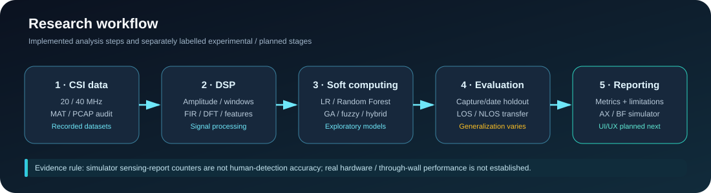
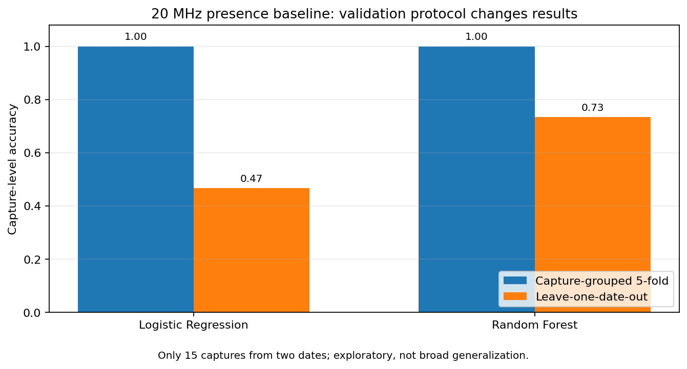
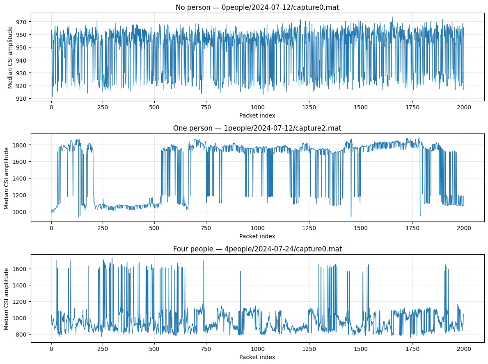
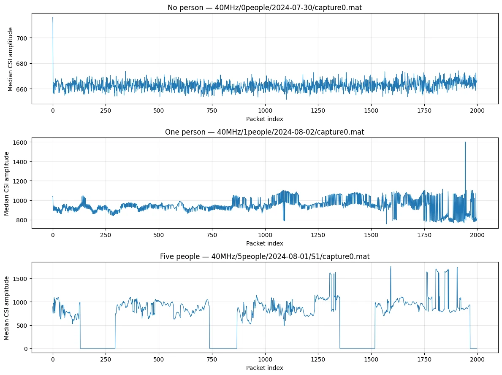
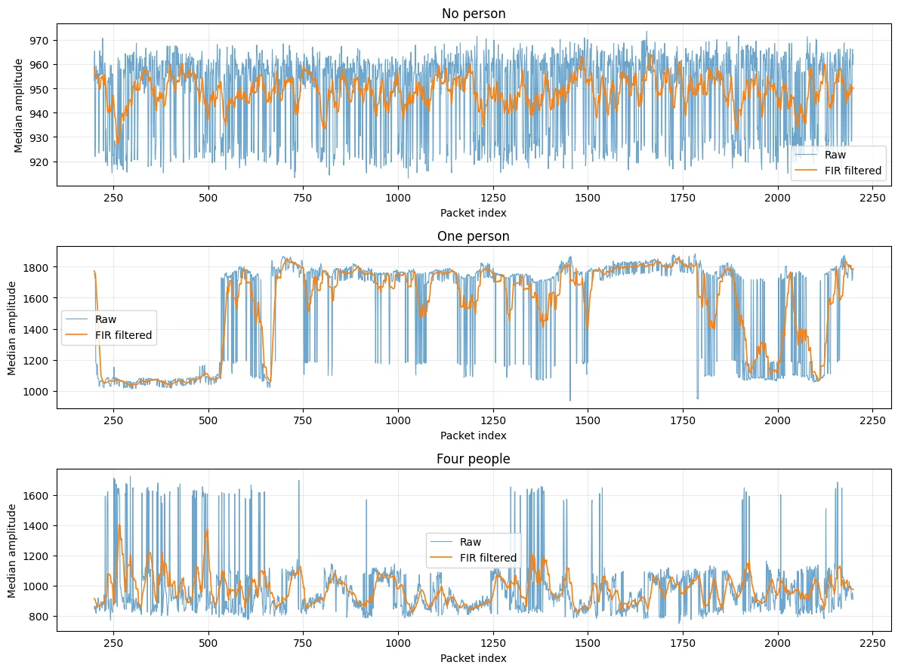
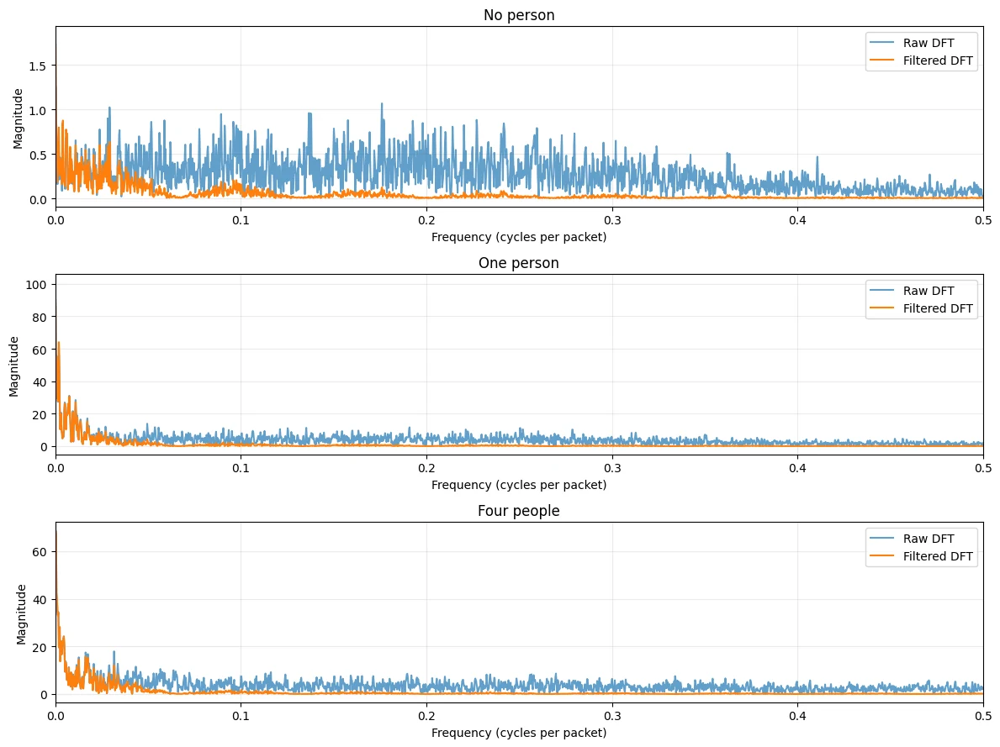
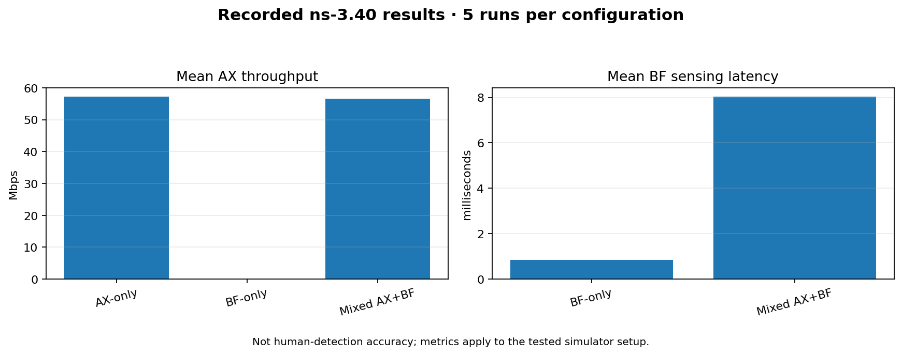

# ORBIT Ultimate — Wi-Fi 6 CSI Human Presence & Activity Sensing

A local research lab for recorded Wi-Fi CSI, DSP, machine learning, and soft computing. A laptop hosts the app and phone workspace. Orbit keeps recorded detection experiments, ns-3 research, and ordinary file transfers distinct.

## Spatial milestone · 5.0

Open **Signal lab → 3D Sensing Studio** for an actual WebGL human/room environment with orbit/pan/zoom, synchronized generated/recorded replay, CSI/DSP/FFT/STFT and motion analysis. The scene is an explanation, not a recovered human pose. Existing modules and the local phone server remain. [Demo guide](docs/ORBIT_DEMO_GUIDE.md) · [honest reference parity](docs/REFERENCE_VIDEO_FEATURE_MATRIX.md) · [tests and limits](docs/ORBIT_ACCEPTANCE_RESULTS.md). This milestone does not establish physical phone/RF/clinical acceptance or100%project completion.

## App checkpoint · 4.4

Command center adds a procedural 3D explainer, gap-aware same-input DSP graphs, subcarrier maps and links to matched model evidence. The acoustic receiver now handles a clipped training preamble while retaining CRC/AEAD/hash validation. [4.4 guide](docs/command_center_release_4_4.md).

The existing interface and research gallery are retained. Connected workbench adds shared file lifecycle, offline English transcription, reproducible DSP workflows, generated modulation/BER practicals, reference-based research tools and device diagnostics. AcousticLink adds SECDED, selectable rates and a sender-bound decoded ACK path; APK 4.3 adds preview-first native photo/voice workflows and secure media permission support.

[Current checklist and remaining boundaries](docs/ORBIT_PROJECT_CHECKLIST.md) · [Install and test guide](docs/professional_release_4_3.md). Physical phone/audio/CSI/SDR acceptance, missing original SmartCSI artifacts and independent clinical validation are not asserted as completed. Wi-Fi transfer is not evidence of live CSI or AX/BF superiority.

## Research at a glance

| Original CSI graphs | What to look for |
|---|---|
| [20 MHz amplitude](assets/assets/csi_20mhz_examples.webp) · [40 MHz amplitude](assets/assets/csi_40mhz_examples.webp) | Changes across recorded packets and subcarriers |
| [FIR comparison](assets/assets/fir_filter_comparison.webp) · [DFT spectrum](assets/assets/dft_spectrum_comparison.webp) | How the original notebook's filter changed the waveform and frequency content |
| [Validation protocols](assets/assets/validation_protocol_comparison.png) · [Original AX/BF comparison](assets/assets/phase7_simulator_results.png) | How the split changed capture scores and how the partial simulator measured throughput and sensing latency |

Original CSI, FIR, DFT and AX/BF graphs

The figures are archived outputs. The original AX/BF plot is from a five-run-per-configuration partial ns-3.40 experiment. The separate SAGE V3 study used 12 seeds and reported a severe-fading AX-only throughput gain alongside lower successful BF report rates in matched mixed-mode comparisons. The research history keeps both protocols and the recorded CSI results separate. [Research notebook](https://colab.research.google.com/drive/1iFoaTazemwuRKRnVC7APWzceNzxh0OiK?usp=sharing) · [Original research history](docs/research_history.md) · [Research Journey and SAGE V3](docs/research_journey.md)

## Orbit progress

| Area | Current status |
|---|---|
| Recorded CSI and Evidence | Quality-aware feature extraction, grouped training, held-out Replay, and a separate matched Hamming FIR experiment using the same features and held-out dates. |
| Phone exchange | One-time QR, resumable hash-verified exchange, chat, and a server-measured upload timeline. Physical Android acceptance pending. |
| Audio and MATLAB | Verified transferred WAVs can enter Audio Studio, be filtered into linked Library copies, and be reopened for a bounded comparison in optional licensed MATLAB. |
| Additional labs | Software BFSK loopback, generated or recorded I/Q SDR, Camera Studio, and local MATLAB/Simulink fixture comparisons |
| Retinal Image Lab | Consented photo enhancement and vessel-candidate masks through Python or licensed MATLAB, with Library save and measured timings. Software verification uses generated geometry. |

[Current checklist](docs/ORBIT_PROJECT_CHECKLIST.md) · [Implementation status](docs/ORBIT_ULTIMATE_STATUS.md) · [Test record](docs/ORBIT_ULTIMATE_TEST_RESULTS.md)

## Windows application

Extract the Windows download fully, then open **Orbit.exe**. It includes Python and the scientific runtime. The native window uses Microsoft Edge WebView2. Keep the app open while using your phone.

For a server without the desktop window, run **Start-Orbit-Server.cmd**, or:

    Orbit.exe --server

Use --port 8766 for another port, or --local-only to disable LAN binding. The app does not change firewall rules; allow the private-network prompt yourself when appropriate.

## Phone

Install the APK, then create a one-use QR in **Connect** on the laptop. Scan/open the link on the phone; pairing avoids entering the session code. The app reconnects while its session remains valid. Android Share → Orbit accepts files; choose them in Import wizard. Offline examples can be saved from the app connection screen.

The APK permits HTTP only to its build-time private laptop IPs. If an IP changes, rebuild with --lan-host or use the phone browser. orbit.local discovery depends on mDNS; numeric LAN URLs remain available. The phone scientific workspace requires the laptop server.

## Source / offline Python launch

Windows x64 CPython 3.10:

    python tools/prepare_offline.py
    python launch_orbit.py --offline --lan

The first command prepares wheels online; the downloadable source bundle already includes them. Add --check-install to verify dependencies without starting the server. Other Python versions need matching wheels. The frontend is prebuilt; development uses npm ci and npm run build in frontend/.

## Workflow

Home → Library (files, folders, ZIP, MAT, numeric CSV/NPY/NPZ) → Signal Studio → Learning Lab → Replay. Use Import wizard for missing metadata. Uploads resume by hash/offset; duplicates are detected. Inbox collects phone imports and manual tap labels. Removed datasets can be restored from Inbox.

Simulation contains generated empty/still/moving/two-person channels. It has a separate library/models and a visible Simulation chip. Generated outputs always retain synthetic=true; they are excluded from Evidence. Recording plan prepares balanced real-lab sessions with consent and metadata checks.

DSP & SC tools extends filters, FFT, aliasing, pole-zero views, convolution, spectrograms, the ANN ladder, SOM, fuzzy defuzzification, quality gating, nested GA DSP search and heuristic model fusion. Orbit guide is offline rule-based help, not an external AI model.

## Validation and limits

Replay defaults to saved outer-fold predictions. Scaling, GA feature selection and tuning exclude held-out recordings/dates. Final-model inference is explicitly labelled. Metrics carry validation protocols; small datasets and date/class confounding remain limitations. Simulated results do not establish real-world accuracy. No verified live CSI, through-wall detection or native 802.11bf support is claimed.

Run python -m pytest tests -q and python -m ruff check orbit tests tools desktop.py build_desktop.py launch_orbit.py. Verify file bytes with python tools/checksums.py --verify. See CHANGELOG.md, docs/step1_audit.md and [the preserved research history](docs/research_history.md).

## New local communication and acoustic DSP tools

Connect → fresh QR → Transfer & chat. General files up to 256 MiB are separate from CSI imports. Open **View upload graph** for server-accepted bytes and observed application throughput. For a verified PCM16 WAV, **Save & analyze WAV** opens Audio Studio with playback, waveform, spectrum, spectrogram, and non-destructive filtering. Use Audio Studio on the laptop for optional MATLAB comparison and Trash controls. Sessions expire server-side after 12 hours.

Signal lab -> Acoustic modem: UTF-8 BFSK at 1200/2200 Hz, 100 bit/s, preamble/length/CRC32. Generated speaker WAV, noisy loopback and PCM WAV decode. Microphone capture needs a supported secure context and permission; phone LAN HTTP commonly blocks it. Physical acoustic tests, AgentLink, calls, live SDR and MATLAB Engine remain unverified or pending.

Grouped navigation preserves existing pages. See docs/ORBIT_ULTIMATE_STATUS.md and feature inventory. No new mandatory libraries; existing NumPy/SciPy/scikit-learn BSD-family licenses and FastAPI MIT metadata inspected. MATLAB remains optional.
