# ORBIT image and graph gallery

All images below are existing screenshots or preserved research outputs. No new
accuracy, benchmark or illustrative clinical result was fabricated. Current app
views, historical screens, recorded CSI plots and network simulations are labelled.
Click an image to open its original file. The downloadable pack also contains an
offline searchable index, hashes, source captions, feature list and demo guide.

## App Current

### orbit-shared-data-room

Actual 5.1 browser render / software demonstration. Simulation avatars are supplied paths, not inferred Wi-Fi poses; mobile views are browser checks.

[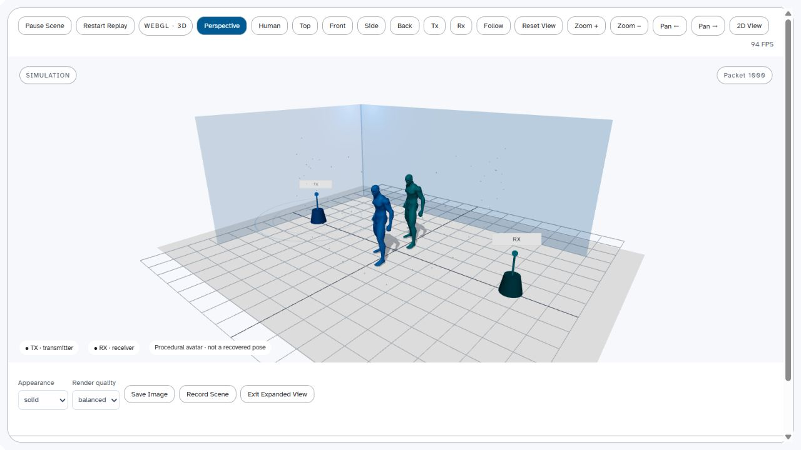](images/orbit-shared-data-room.png)

### orbit-shared-data-dsp

Actual 5.1 browser render / software demonstration. Simulation avatars are supplied paths, not inferred Wi-Fi poses; mobile views are browser checks.

[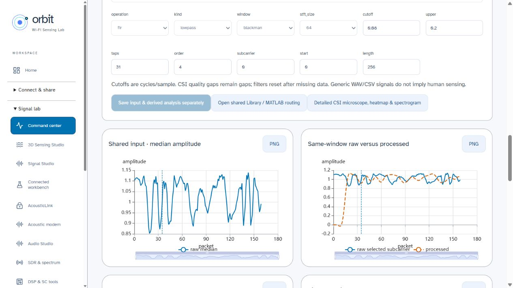](images/orbit-shared-data-dsp.png)

### orbit-shared-data-transfer

Actual 5.1 browser render / software demonstration. Simulation avatars are supplied paths, not inferred Wi-Fi poses; mobile views are browser checks.

[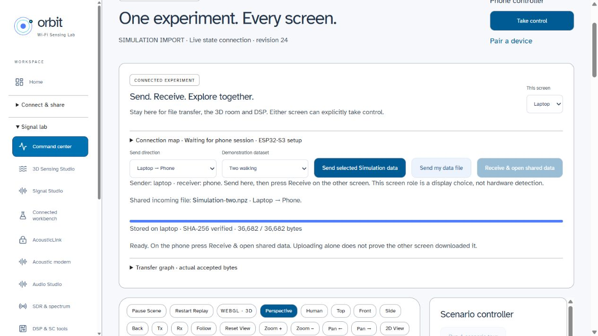](images/orbit-shared-data-transfer.png)

### orbit-5.1-final-shared-command

Actual 5.1 browser render / software demonstration. Simulation avatars are supplied paths, not inferred Wi-Fi poses; mobile views are browser checks.

[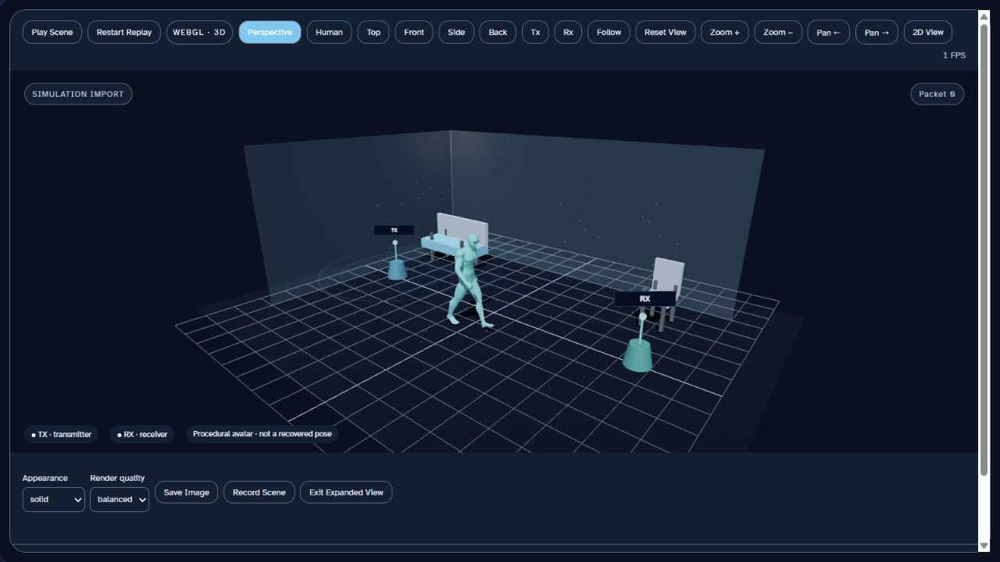](images/orbit-5.1-final-shared-command.png)

### orbit-5.1-phone-layout

Actual 5.1 browser render / software demonstration. Simulation avatars are supplied paths, not inferred Wi-Fi poses; mobile views are browser checks.

### orbit-5.1-received-file-dsp-dark

Actual 5.1 browser render / software demonstration. Simulation avatars are supplied paths, not inferred Wi-Fi poses; mobile views are browser checks.

[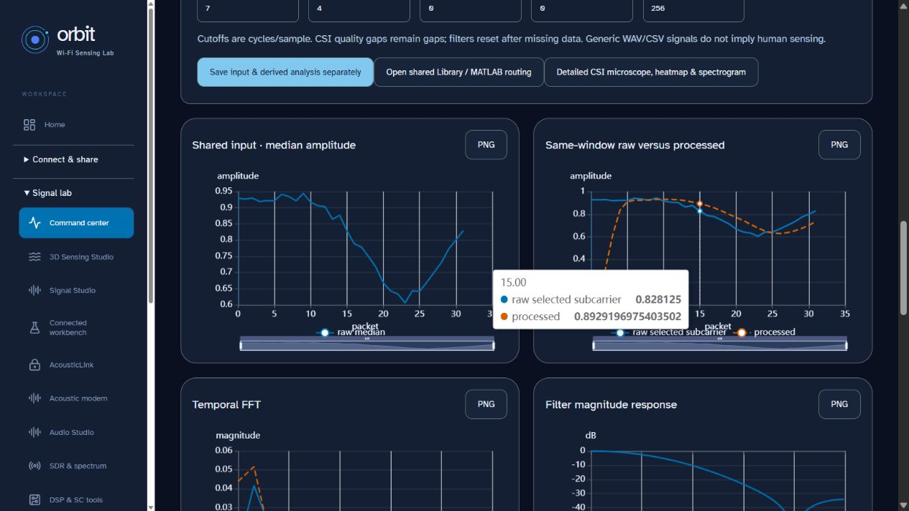](images/orbit-5.1-received-file-dsp-dark.png)

## Original Csi Dsp

### csi_20mhz_examples

Archived research output; see docs/model_comparison_20mhz_40mhz.md and docs/research_history.md for the recorded/simulator protocol. Not a new run.

[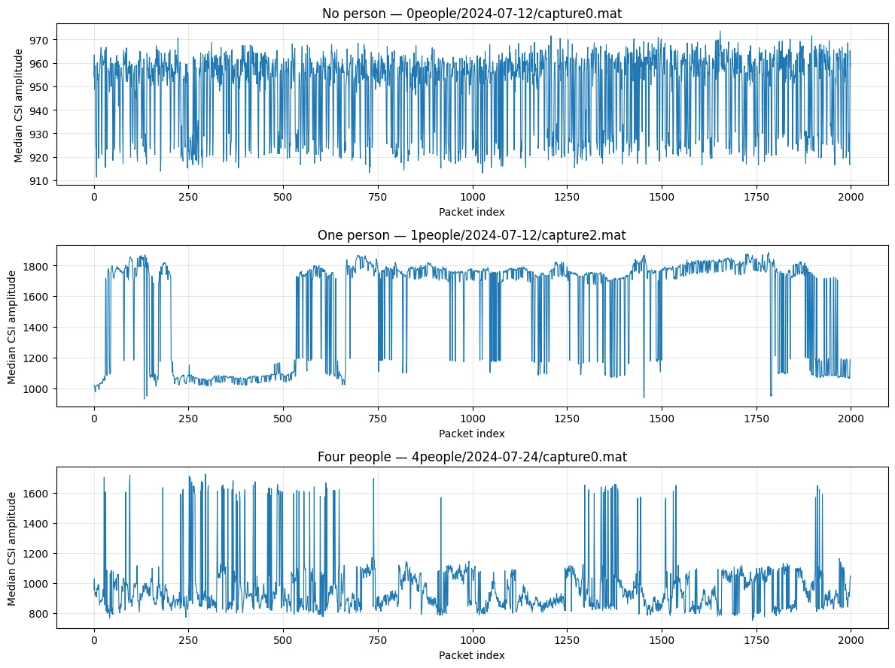](../assets/assets/csi_20mhz_examples.webp)

### csi_40mhz_examples

Archived research output; see docs/model_comparison_20mhz_40mhz.md and docs/research_history.md for the recorded/simulator protocol. Not a new run.

[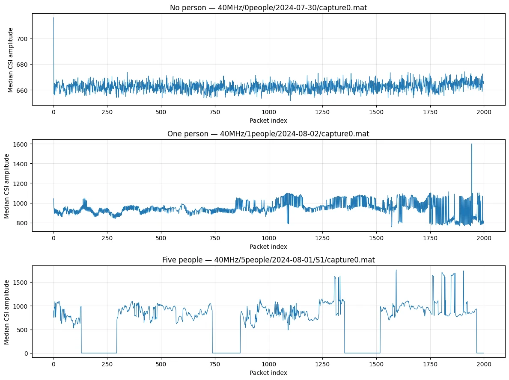](../assets/assets/csi_40mhz_examples.webp)

### dft_spectrum_comparison

Archived research output; see docs/model_comparison_20mhz_40mhz.md and docs/research_history.md for the recorded/simulator protocol. Not a new run.

[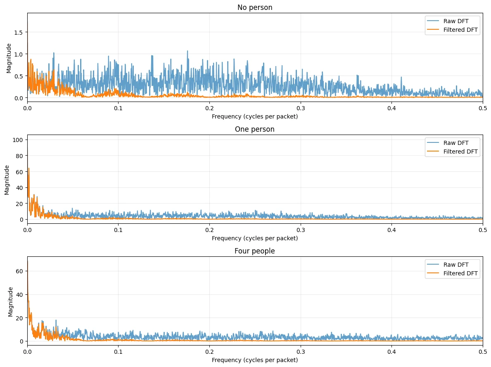](../assets/assets/dft_spectrum_comparison.webp)

### fir_filter_comparison

Archived research output; see docs/model_comparison_20mhz_40mhz.md and docs/research_history.md for the recorded/simulator protocol. Not a new run.

[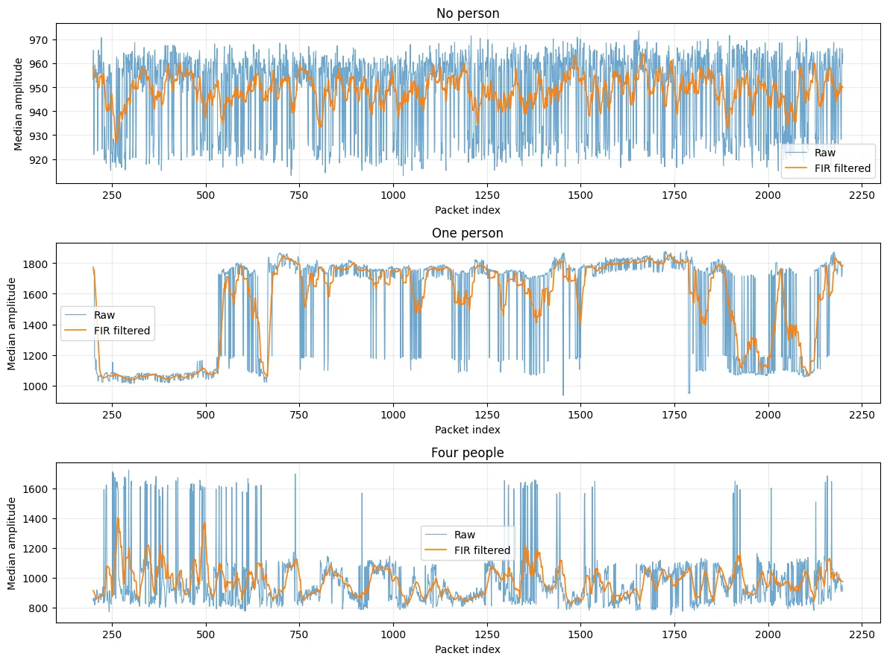](../assets/assets/fir_filter_comparison.webp)

### phase7_simulator_results

Archived research output; see docs/model_comparison_20mhz_40mhz.md and docs/research_history.md for the recorded/simulator protocol. Not a new run.

[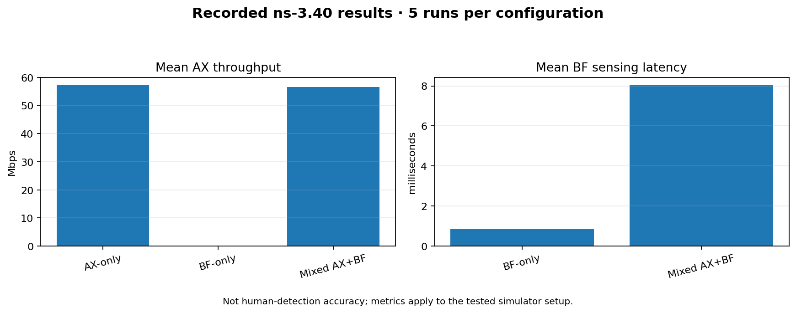](../assets/assets/phase7_simulator_results.png)

### project_pipeline

Original project pipeline diagram; explanatory, not measured output.

[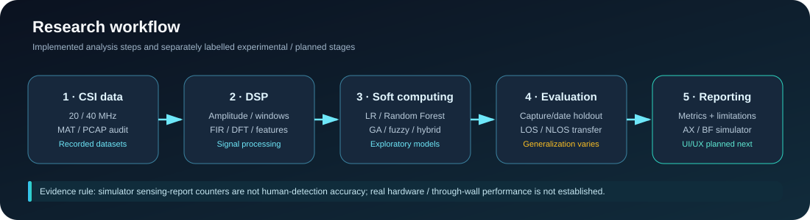](../assets/assets/project_pipeline.svg)

### validation_protocol_comparison

Archived research output; see docs/model_comparison_20mhz_40mhz.md and docs/research_history.md for the recorded/simulator protocol. Not a new run.

[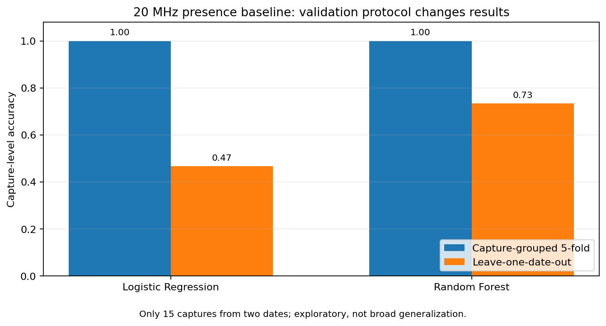](../assets/assets/validation_protocol_comparison.png)

## Confusion Matrices

### confusion_matrix_20mhz_ann_mlp

Recorded 20 MHz, 15 captures, two-date leave-one-recording-date-out; window-vote capture decision. Small cohort.

[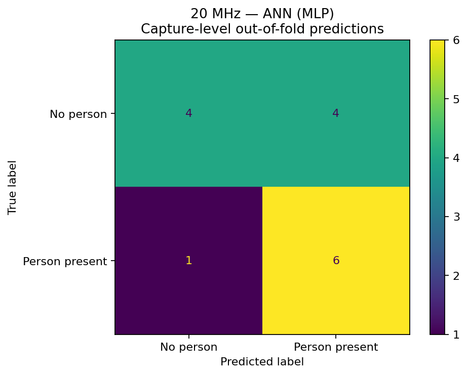](../results/figures/confusion_matrix_20mhz_ann_mlp.png)

### confusion_matrix_20mhz_logistic_regression

Recorded 20 MHz, 15 captures, two-date leave-one-recording-date-out; window-vote capture decision. Small cohort.

[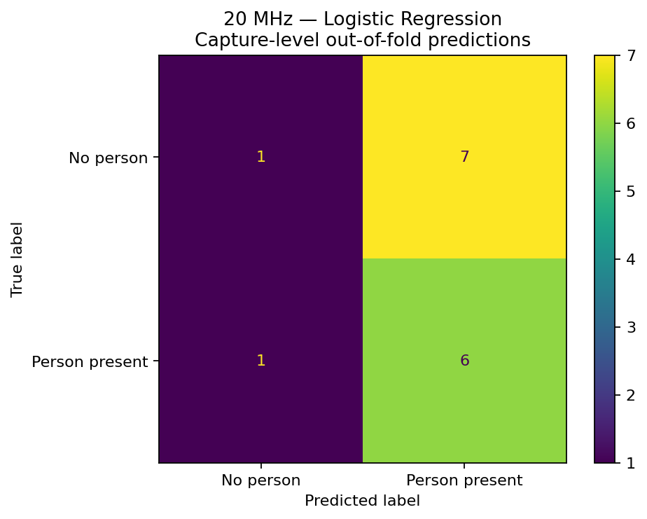](../results/figures/confusion_matrix_20mhz_logistic_regression.png)

### confusion_matrix_20mhz_random_forest

Recorded 20 MHz, 15 captures, two-date leave-one-recording-date-out; window-vote capture decision. Small cohort.

[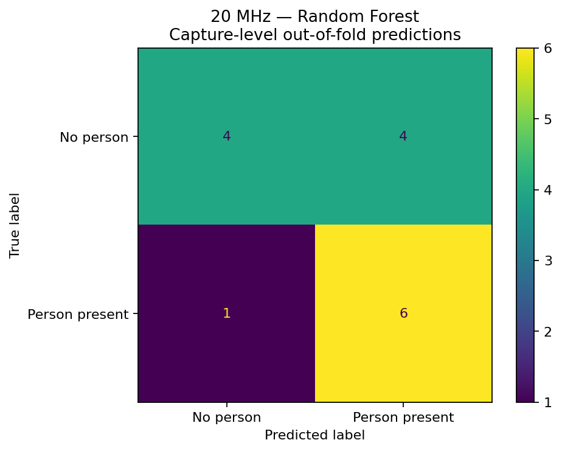](../results/figures/confusion_matrix_20mhz_random_forest.png)

### confusion_matrix_40mhz_ann_mlp

Recorded 40 MHz, 11 captures, exploratory leave-one-MAT-capture-out. Date/class confounding; NOT independent date-held-out generalization.

[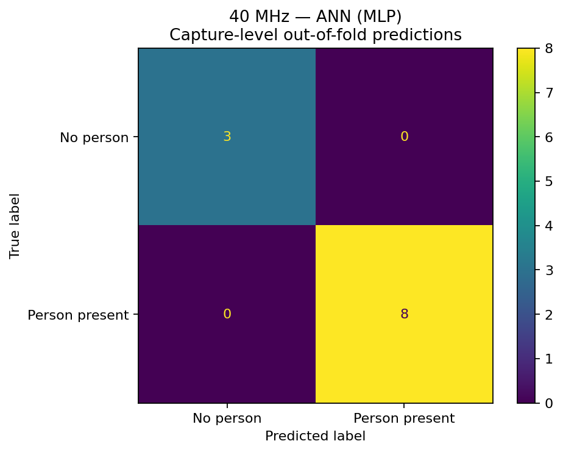](../results/figures/confusion_matrix_40mhz_ann_mlp.png)

### confusion_matrix_40mhz_logistic_regression

Recorded 40 MHz, 11 captures, exploratory leave-one-MAT-capture-out. Date/class confounding; NOT independent date-held-out generalization.

### confusion_matrix_40mhz_random_forest

Recorded 40 MHz, 11 captures, exploratory leave-one-MAT-capture-out. Date/class confounding; NOT independent date-held-out generalization.

## Research Journey

### graph-01

Initial AX versus AX+BF. Archived ns-3 network simulation. Sensing adds overhead; AX-only 57.1786 Mbps remains above the tested BF intervals. Original PDF page(s): 292.

[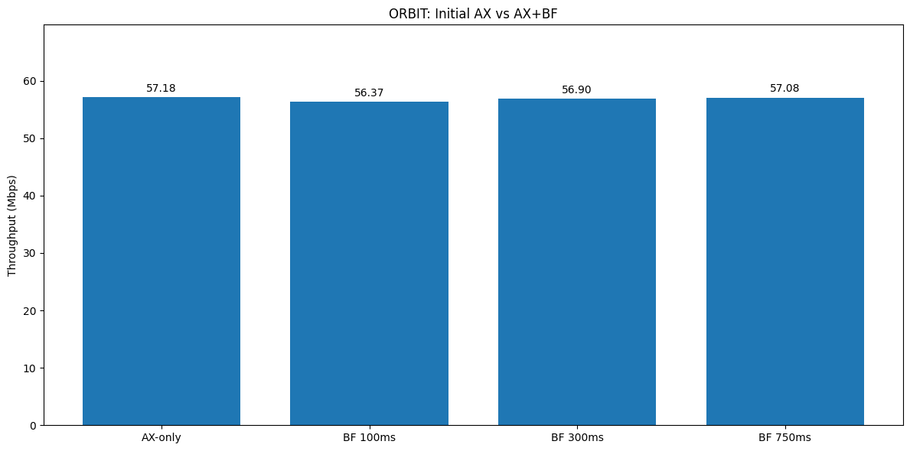](research-figures/graph-01.png)

### graph-02

Sensing interval optimization. Archived ns-3 network simulation. Longer intervals reduce sensing overhead; throughput alone does not establish sensing quality. Original PDF page(s): 292.

[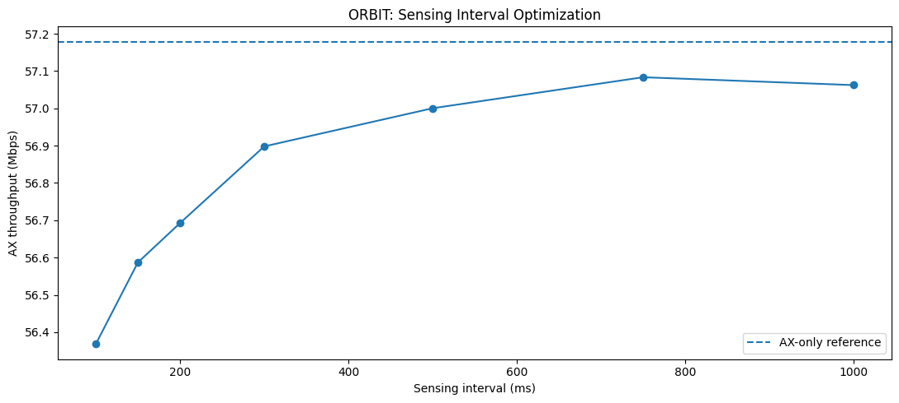](research-figures/graph-02.png)

### graph-03

Sensing availability. Archived ns-3 network simulation. Report rate falls as sensing interval increases. The 3 reports/s line is an illustrative target. Original PDF page(s): 292.

[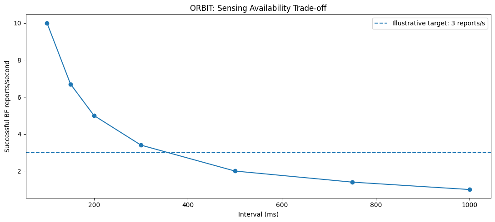](research-figures/graph-03.png)

### graph-04

Matched MCS and payload. Archived ns-3 network simulation. Compare matching MCS/payload settings; mixed AX+BF does not beat its matched AX baseline. Original PDF page(s): 292, 293.

[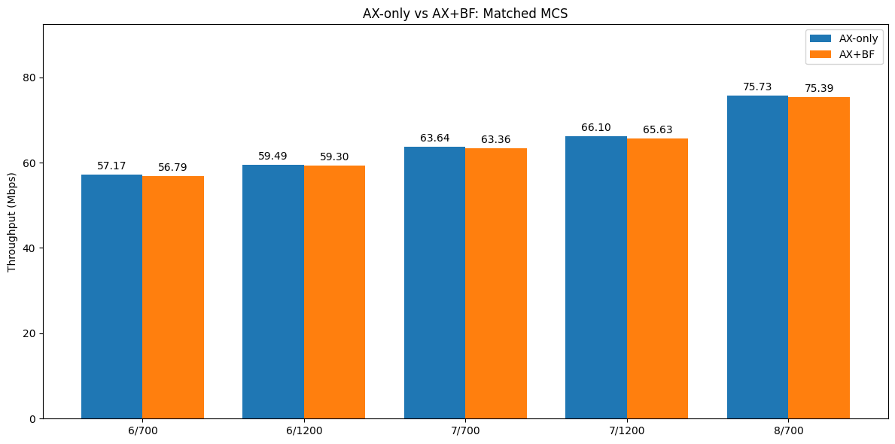](research-figures/graph-04.png)

### graph-05

Guard interval and contention window. Archived ns-3 network simulation. Tuning helps both modes. Improved AX+BF does not establish superiority over equally tuned AX. Original PDF page(s): 293.

[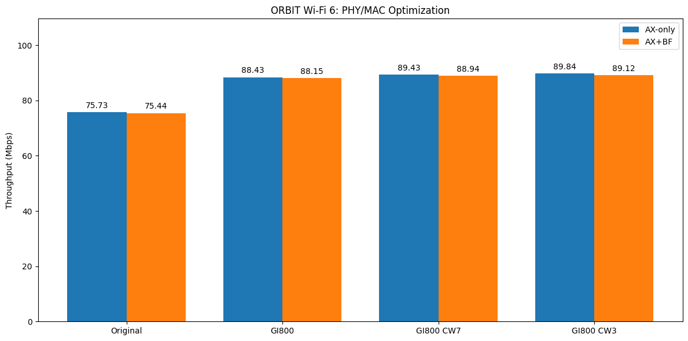](research-figures/graph-05.png)

### graph-06

Spatial reuse ON/OFF. Archived ns-3 network simulation. OBSS-PD is an existing Wi-Fi 6 feature. Two-BSS total throughput depends on separation and geometry. Original PDF page(s): 293.

[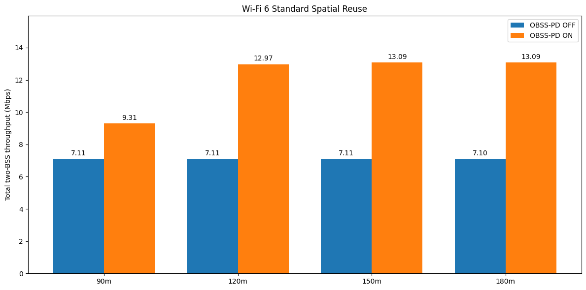](research-figures/graph-06.png)

### graph-07

Spatial reuse gain. Archived ns-3 network simulation. Up to 84.288% in these layouts; not a new standard feature invented by this project. Original PDF page(s): 293, 294.

[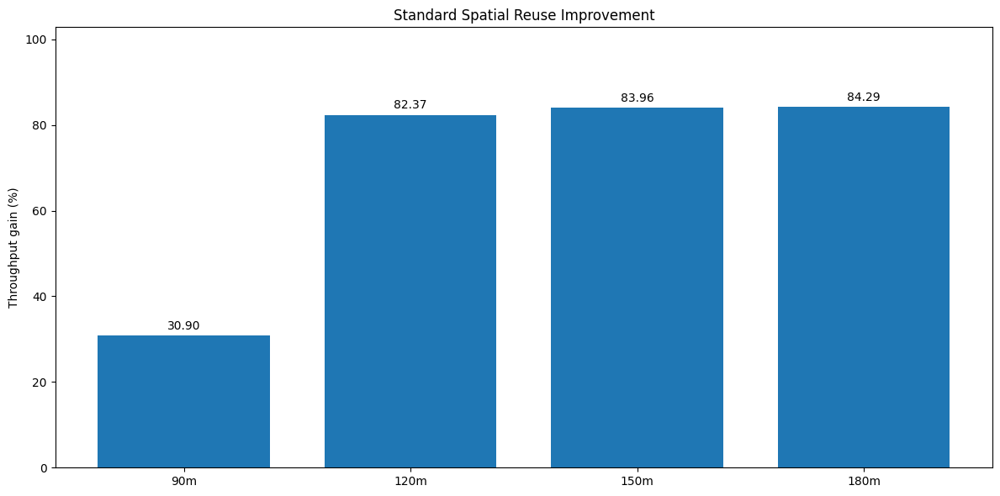](research-figures/graph-07.png)

### graph-08

SARA V1. Archived ns-3 network simulation. Standard, best fixed and SARA V1 each report 12.7624 Mbps. Original PDF page(s): 294.

[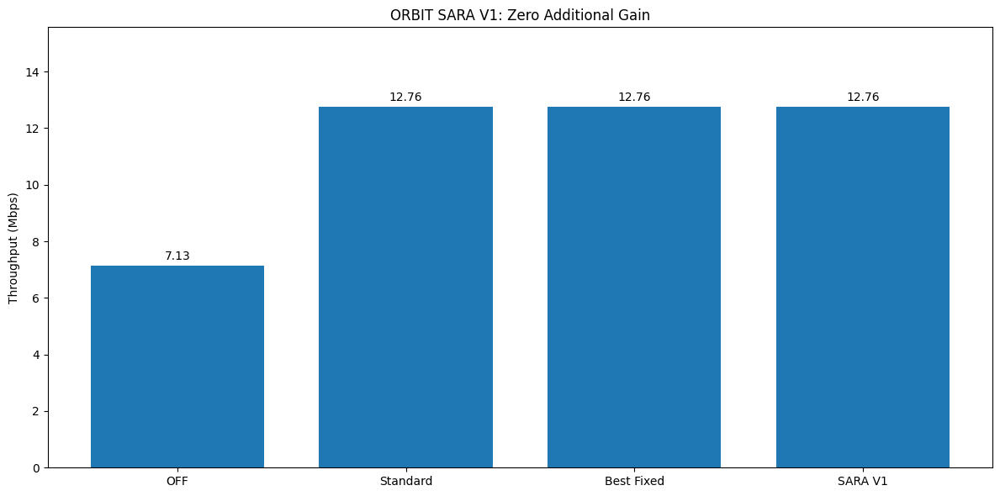](research-figures/graph-08.png)

### graph-09

SARA V2. Archived ns-3 network simulation. The displayed challenging-layout tests do not show extra gain over standard/best tested settings. Original PDF page(s): 294.

[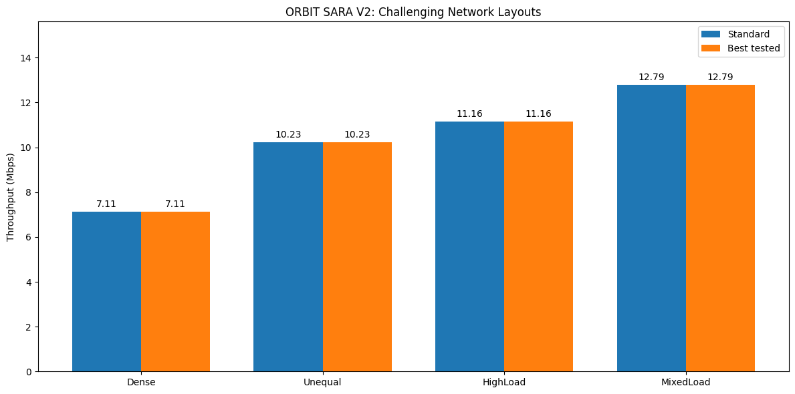](research-figures/graph-09.png)

### graph-10

SAGE V1/V2 link model. Simplified link simulation. Not ns-3. V1/V2 can underperform ACK adaptation; interference is a different result. Original PDF page(s): 294.

[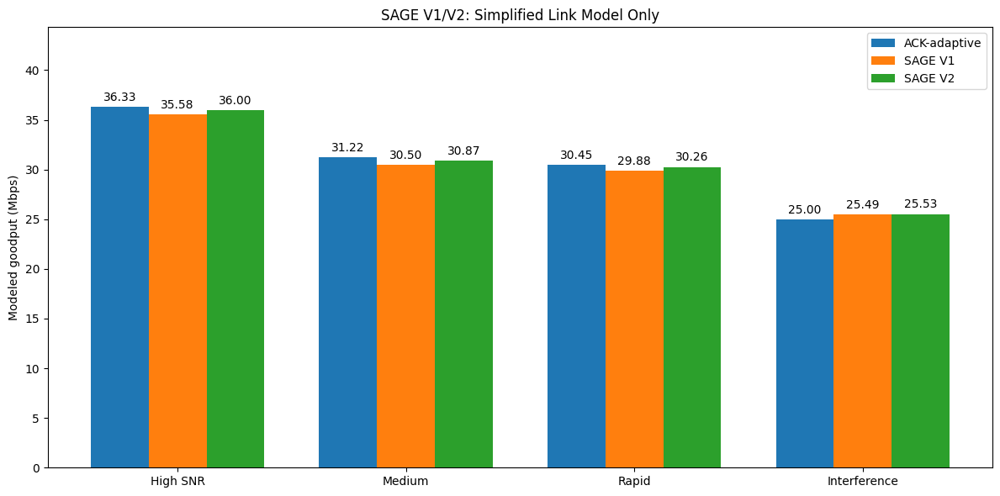](research-figures/graph-10.png)

### graph-11

SAGE V3 stable channel. Archived ns-3 simulation. AX-only is unchanged at 103.481 Mbps; mixed changes from 103.0558 to 103.0520 Mbps. Original PDF page(s): 294, 295.

[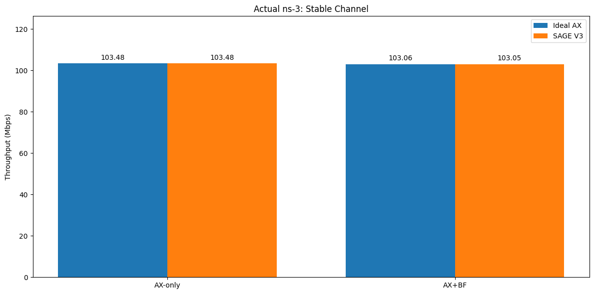](research-figures/graph-11.png)

### graph-12

SAGE V3 fading throughput. Archived 12-seed ns-3 validation. IdealWifiManager baseline; seeds 1101-1112. Not hardware, and event traces may differ between controllers. Original PDF page(s): 295.

[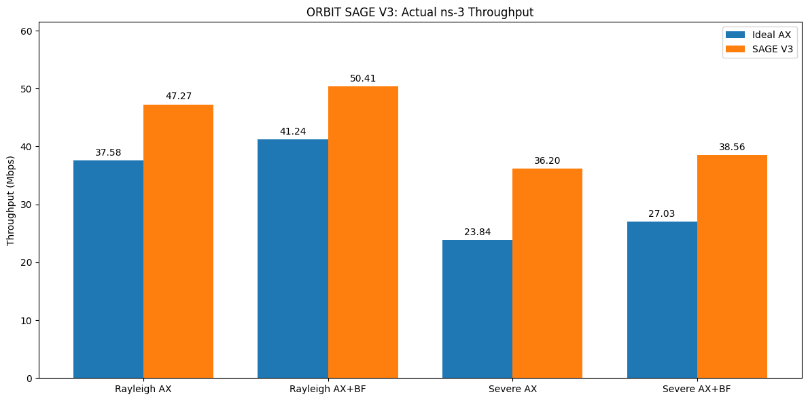](research-figures/graph-12.png)

### graph-13

SAGE V3 relative gains. Archived 12-seed ns-3 validation. Largest reported AX-only severe-fading gain: 51.864%, displayed as 51.86%. Relative gain is not percentage points. Original PDF page(s): 295.

[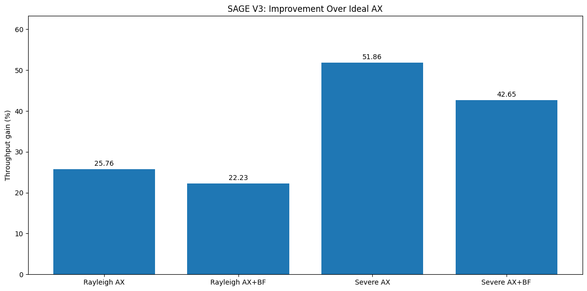](research-figures/graph-13.png)

### graph-14

BF successful reports. Archived 12-seed ns-3 validation. Rayleigh: 2.958 to 2.667 reports/s; severe: 2.492 to 1.933. Communication gain is not sensing reliability gain. Original PDF page(s): 295, 296.

[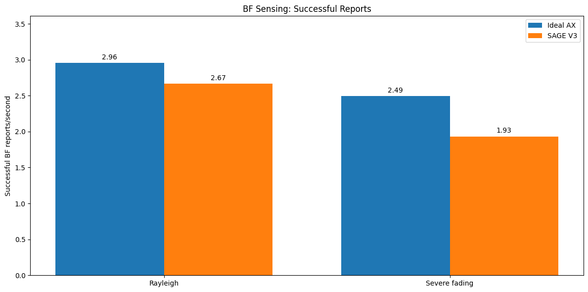](research-figures/graph-14.png)

### graph-15

BF failed reports. Archived 12-seed ns-3 validation. Mean failures per 10-second run rise: Rayleigh 2.250 to 4.667; severe 5.500 to 10.833. Original PDF page(s): 296.

[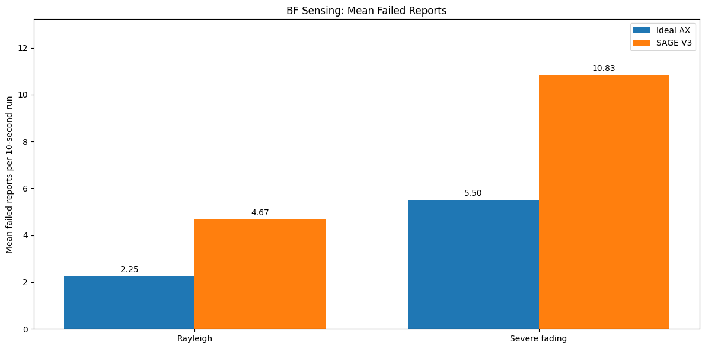](research-figures/graph-15.png)

### graph-16

SmartCSI accuracy. 15 recorded captures; exploratory score fusion. 73.33%, 86.67%, 93.33%. Base scores are date-held-out; the final rule was explored using available results. Independent validation needed. Original PDF page(s): 296.

[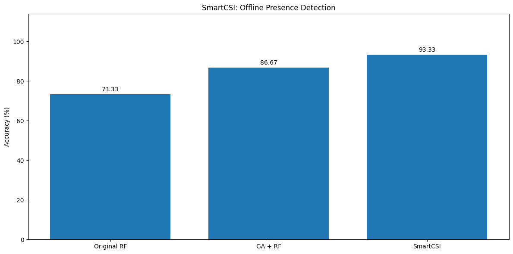](research-figures/graph-16.png)

### graph-17

SmartCSI false alarms. Same 15-capture offline experiment. False alarms 4 to 2 to 1. This is not network throughput or verified live detection. Original PDF page(s): 296, 297.

[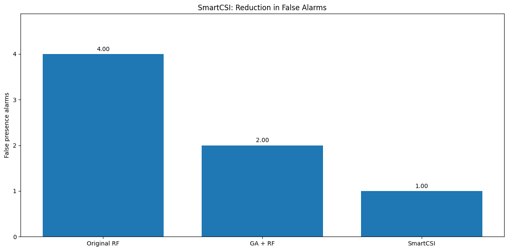](research-figures/graph-17.png)

### graph-18

GA feature reduction. Offline CSI feature selection. 1024 to 13 = 98.7305% reduction. Fold masks are needed for full reproduction; not all app runs use this mask. Original PDF page(s): 297.

[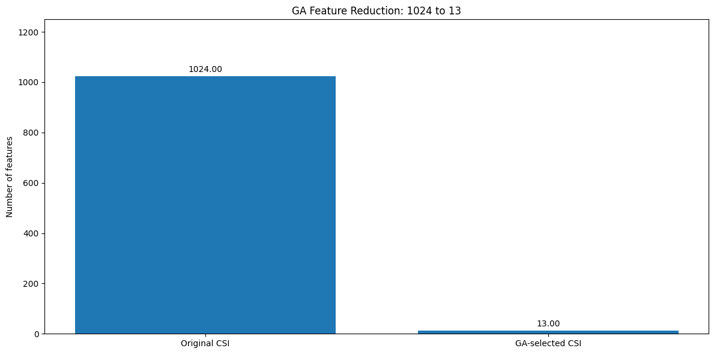](research-figures/graph-18.png)

### graph-19

Final archived dashboard. Archived synthesis of distinct experiments. Different metrics and protocols remain separate. BF report reliability declined despite communication gains. Original PDF page(s): 297.

[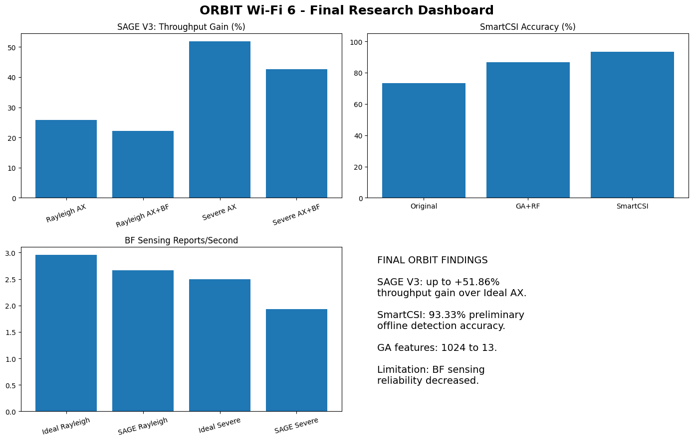](research-figures/graph-19.png)

## App History

### orbit-4.4-before

Preserved earlier app screenshot. Historical interface/progress; not a screenshot of every current screen. Displayed metrics belong to that saved run.

[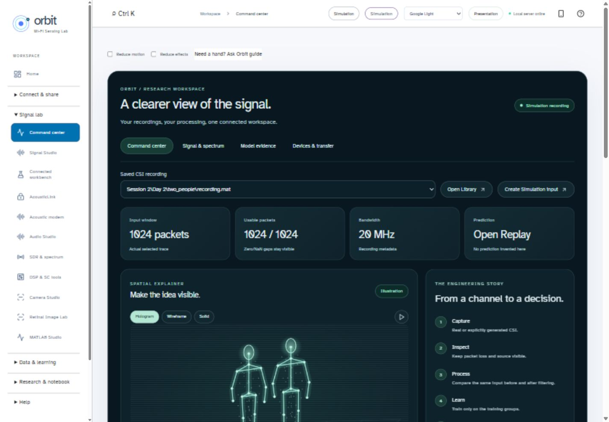](images/orbit-4.4-before.jpg)

### orbit-5.0-3d

Preserved earlier app screenshot. Historical interface/progress; not a screenshot of every current screen. Displayed metrics belong to that saved run.

[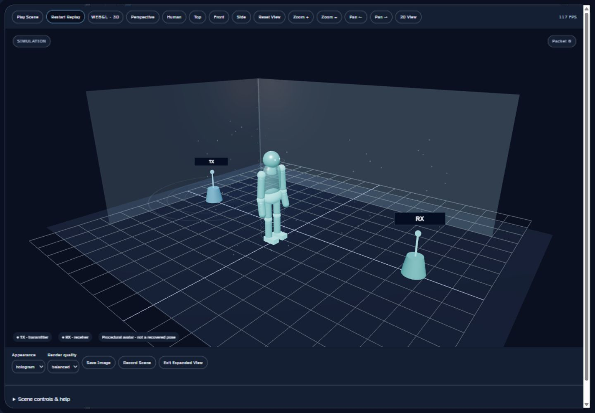](images/orbit-5.0-3d.jpg)

### orbit-5.0-graphite

Preserved earlier app screenshot. Historical interface/progress; not a screenshot of every current screen. Displayed metrics belong to that saved run.

[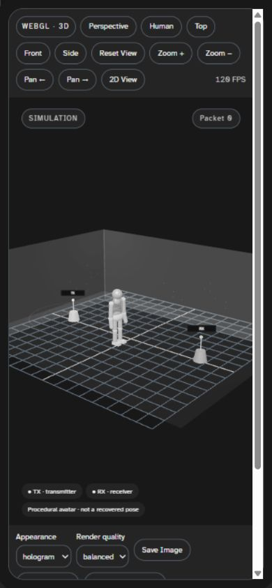](images/orbit-5.0-graphite.jpg)

### orbit-5.0-phone-before-fit

Preserved earlier app screenshot. Historical interface/progress; not a screenshot of every current screen. Displayed metrics belong to that saved run.

[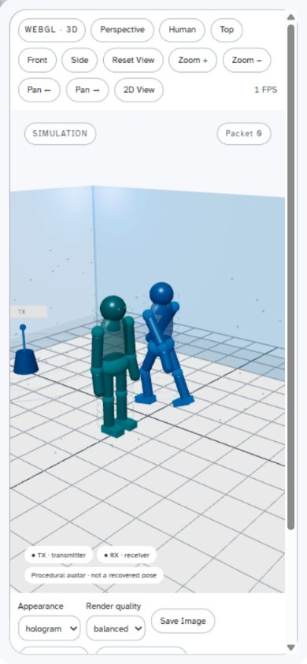](images/orbit-5.0-phone-before-fit.jpg)

### orbit-5.0-phone

Preserved earlier app screenshot. Historical interface/progress; not a screenshot of every current screen. Displayed metrics belong to that saved run.

[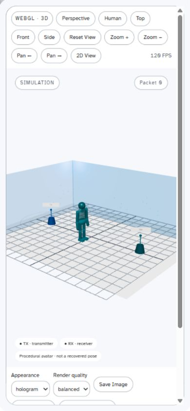](images/orbit-5.0-phone.jpg)

### orbit-5.0-recording-frame

Preserved earlier app screenshot. Historical interface/progress; not a screenshot of every current screen. Displayed metrics belong to that saved run.

[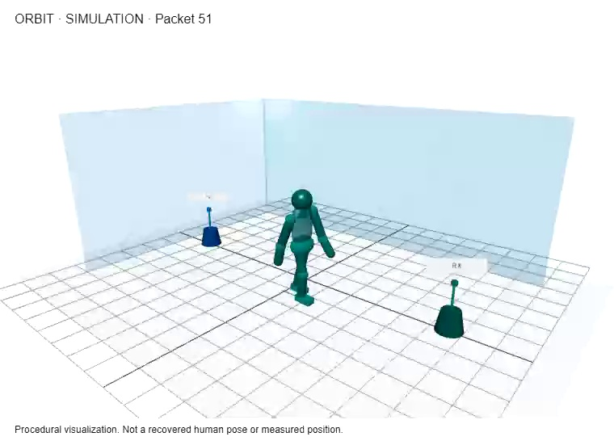](images/orbit-5.0-recording-frame.jpg)

### orbit-comparison

Preserved earlier app screenshot. Historical interface/progress; not a screenshot of every current screen. Displayed metrics belong to that saved run.

[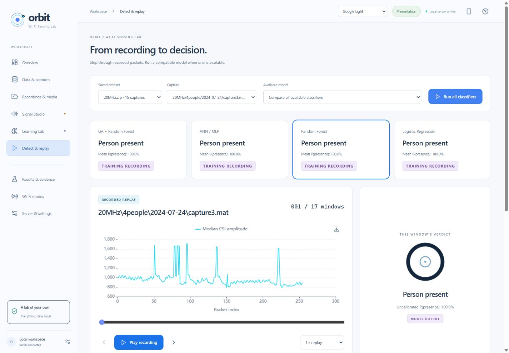](images/orbit-comparison.png)

### orbit-desktop

Preserved earlier app screenshot. Historical interface/progress; not a screenshot of every current screen. Displayed metrics belong to that saved run.

[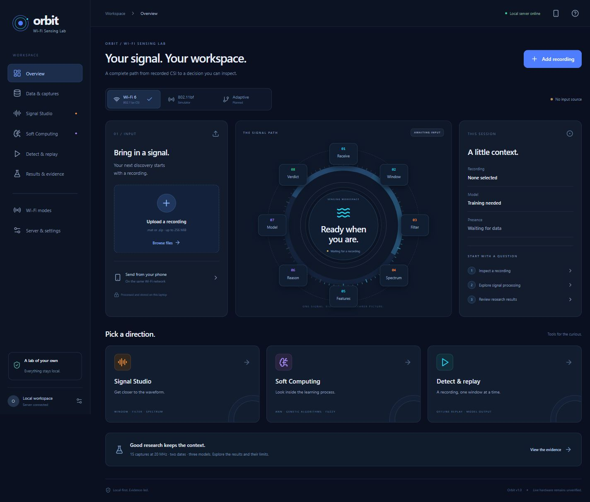](images/orbit-desktop.png)

### orbit-intro

Preserved earlier app screenshot. Historical interface/progress; not a screenshot of every current screen. Displayed metrics belong to that saved run.

[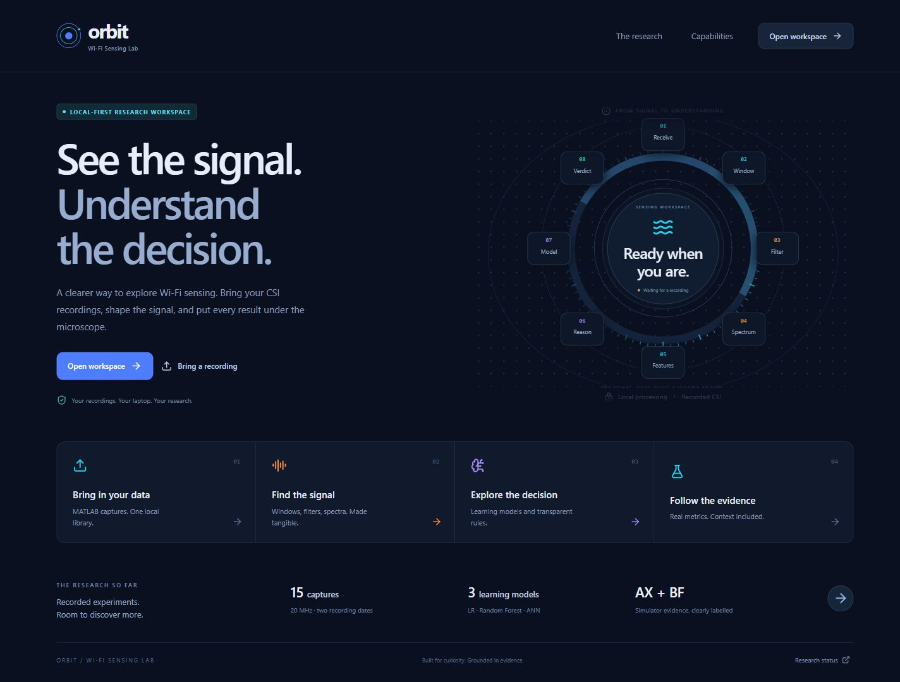](images/orbit-intro.png)

### orbit-mobile

Preserved earlier app screenshot. Historical interface/progress; not a screenshot of every current screen. Displayed metrics belong to that saved run.

[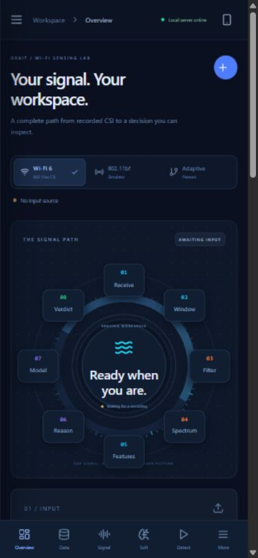](images/orbit-mobile.png)

