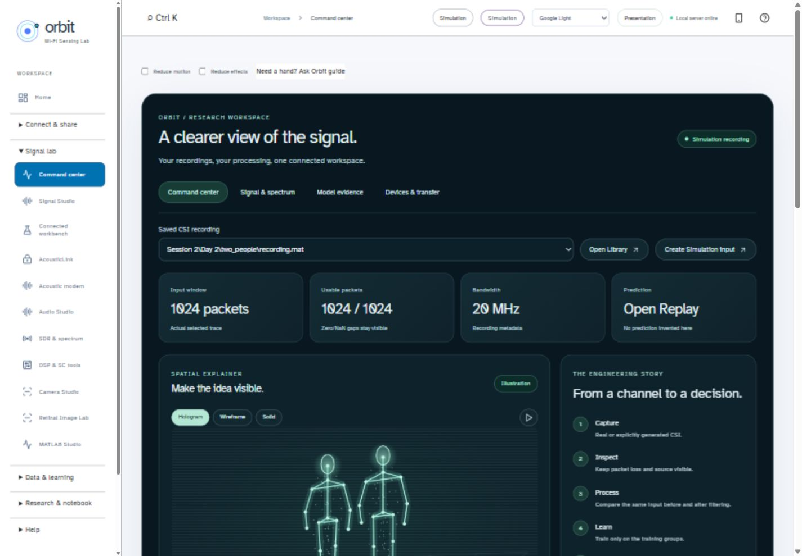
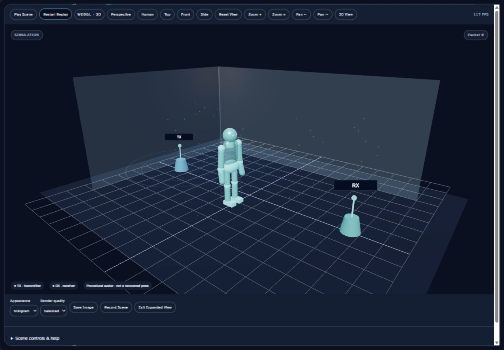
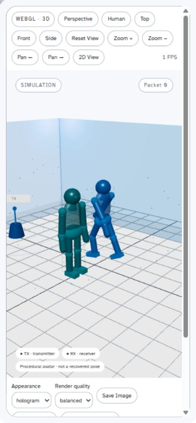
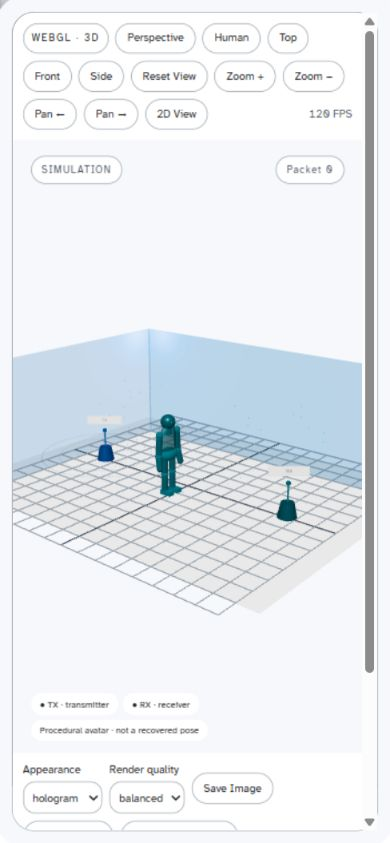
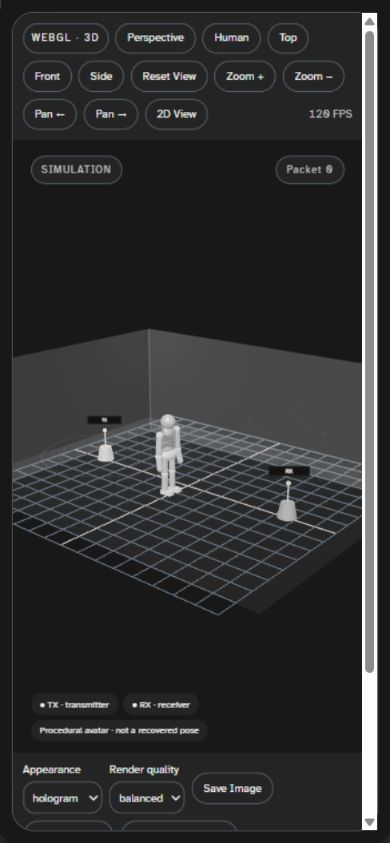
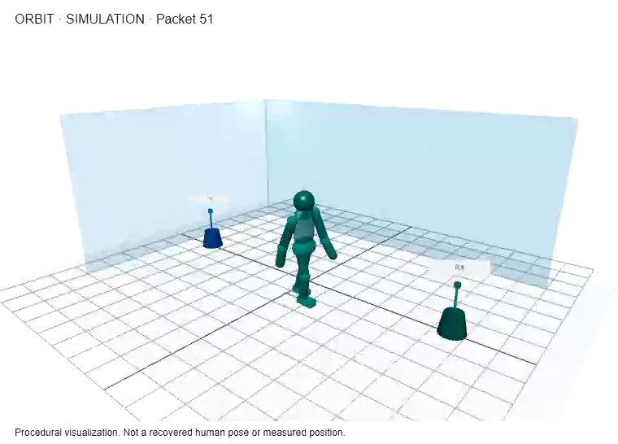

# ORBIT visual audit — 2026-11-09

## Observed before / after

4.4 used a2Dcanvas projection; its “3Dillustration” terminology did not mean a WebGLscene. Its Command center locally overrode the global palette with dark colours.

5.0 renders actual WebGLmeshes, real perspective camera transforms, articulated procedural avatars, walls/floor, beacons, anchored labels and source-labelled data. Expanded view is an actual working viewer, with shared Play/Pause/Restart. No reference assets were copied.

## Phone-width test, not handset acceptance

A390×844browser viewport exposed receiver-marker clipping. The camera now fits the default room to aspect ratio and room dimensions; Human focus deliberately offers a closer view. Both transmitter and receiver are visible after the fix. These images are browser breakpoint tests, **not photographs/screenshots from a physical phone**.

## Executed interactions

- Actual WebGLscene rendered; perspective/top/front/side/human presets, zoom/pan buttons, mouse orbit drag and reset exercised.
- Empty, standing, walking and two-person selections exercised. All12scene layer checkboxes changed state; environment, standing-pose/scenario animation, solid/wireframe/hologram and render-quality selections exercised. Room-width slider responds to keyboard input.
- All18theme options were selected in the actual browser. DOM palette/backgrounds were collected, and text/muted contrast computed on bg/surface: minimum5.738593426:1 in Parchment. This is not a complete all-widget/pixel contrast audit. New mono plots use solid/dashed distinctions;3Dpalette follows mono colours.
- Native fullscreen request was rejected by the IAB host. The in-page expanded-scene fallback and Exit control were then implemented and visually verified. This is not proof that every operating system grants native fullscreen.
- Manual2Dcompatibility mode retained signal graphs, then returned to real WebGL. A camera-reset context-loss regression was observed and fixed. Final natural GPU-driver failure/recovery testing is NOT EXECUTED.
- Raw/filtered waveform, heatmap, complex phase, FFT and STFT were rendered; two matched filter snapshots were captured, with group-delay/pole-zero details. Actual analysis JSON saved to Library.
- Start/Stopreplay capture disabled input changes, saved a segment and replayed it from the list. A stale last-tick bug was fixed: final browser check stopped at packet616 and saved end-exclusive617. Reopen retained617packets,6invalid packets, generated trajectories and saved synthetic threshold2.086(display rounding).
- Shared Library →3Dsensing replay opened the exact selected saved NPZ by assetID; metadata and calibration remained visible.
- Event Jump selected packet51; diagnostics returned actualHTTP200/version5.0.0; theory search “FFT” narrowed the cards and the viva answer expanded.
- Auto tour visibly moved from3Denvironment to CSIexplorer. The automation wait had a3second backend timeout; a later observation confirmed the actual8second transition. This was not an application failure.
- Reduced-effects override appeared; decoration/render-scale controls are limited without changing source arrays. Reduced-motion supports snapping illustrative poses, not resampling input data.

## Actual visualization recording

PNG export and a WebM visualization download were exercised. The WebM decoded to18frames with a burned-in Simulationheader and illustration note. It contains no camera or microphone capture. Offscreen browser throttling was visible: observedFPSranged from1when throttled to roughly85–120during active observations. This is not a60FPSguarantee or a phone-performance measurement.

Remaining visual/interaction acceptance: physical AndroidWebView/touch, full keyboard/screen-reader coverage, every legacy module/widget in every theme, prolonged/low-end performance and natural driver loss. Older independent menus/search/themes/datasets/models were preserved; the software regression suite passed.
